# floorkit-catalog

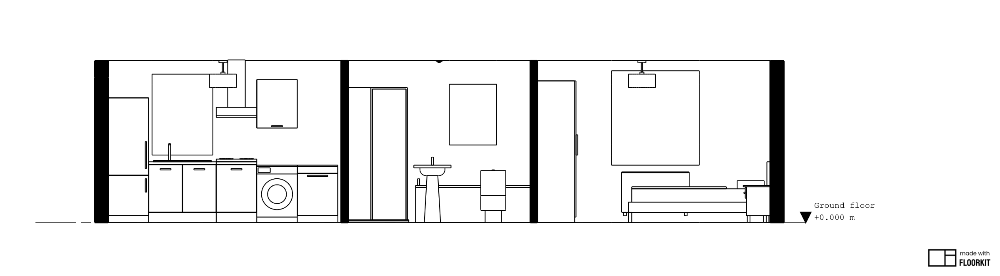

*The demo's section A, drawn by Floorkit from catalog blocks: [`examples/demo.mjs`](examples/demo.mjs), and [`examples/TRY-THIS.md`](examples/TRY-THIS.md) to run it.*

Free, reusable building blocks for [Floorkit](https://ploterr.com/floorkit): furniture, beds, kitchen units, sanitaryware, appliances, lighting, doors, planting, vehicles and data-centre equipment. Each block is one plain JSON `.op` file with a plan symbol, a 3D body and named anchors.

- **81 blocks in 13 categories**, listed in [`index.json`](index.json). Each is drawn to LOD 300 to the [drafting standard](docs/drafting-standard.md). 80 of them are in format 1, and 11 of these also have a version 2.0.0. `shower-enclosure-quadrant` is in format v2 only. The index has 92 entries.
- **Two formats.** The 2.0.0 versions and `shower-enclosure-quadrant` use [format v2](docs/format-v2.md), the curved node kinds of Floorkit 3.0 (arcs, revolves, cones, sectors). The reference loader skips them unless asked with `maxFormat: 2`.
- **A released block never changes.** A fix is a new version in a new file, so a URL pinned to a tag always serves the same bytes.
- **Stricter than Floorkit.** The catalog refuses anything Floorkit would silently repair, so a block draws exactly as written.
- **Blocks are CC BY 4.0; the tools are Apache-2.0.** See [Licence](#licence).

> **Coding agents:** read [AGENTS.md](AGENTS.md) before you change anything in this repository.

## What is in the catalog

One picture per category, and every block in it. Each picture is the `iso.png` that `tools/render.mjs` draws: the triangles Floorkit's kernel builds, coloured by each node's `mat:` role. It is not Floorkit's own viewer.

| | Category (blocks) |
| --- | --- |
| 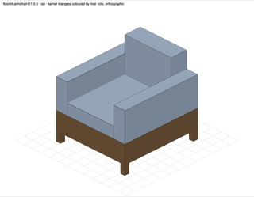 | **seating** (8): `armchair`, `bar-stool`, `bench`, `minimal-sofa`, `office-chair`, `simple-chair`, `sofa-2-seat`, `stacking-chair` |
| 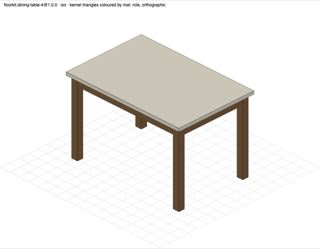 | **tables** (7): `cafe-counter`, `coffee-table`, `dining-table-4`, `meeting-table`, `office-desk`, `round-table`, `table` |
| 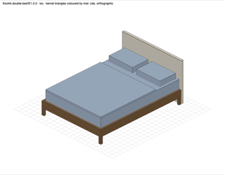 | **beds** (6): `bedside-table`, `bunk-bed`, `cot`, `double-bed`, `king-bed`, `single-bed` |
| 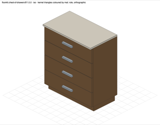 | **storage** (7): `bookshelf`, `cabinet`, `chest-of-drawers`, `desk-pedestal`, `filing-cabinet`, `sideboard`, `wardrobe` |
| 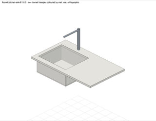 | **kitchen** (7): `base-unit-1000`, `base-unit-600`, `corner-base-unit`, `kitchen-counter`, `kitchen-sink`, `tall-unit-600`, `wall-unit-600` |
| 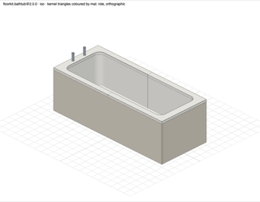 | **sanitary** (13): `basin-accessible`, `bathtub`, `bidet`, `cloakroom-basin`, `shower-enclosure`, `shower-enclosure-quadrant`, `shower-level-access`, `shower-tray`, `urinal`, `wash-basin`, `wc`, `wc-accessible`, `wc-wall-hung` |
| 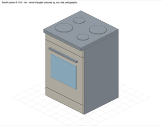 | **appliances** (8): `cooker`, `dishwasher`, `extractor-hood`, `fridge-freezer`, `hob`, `television`, `tumble-dryer`, `washing-machine` |
| 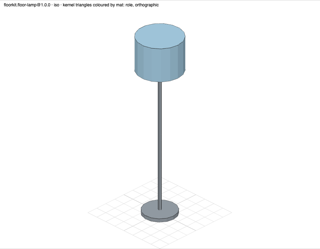 | **lighting** (6): `ceiling-luminaire-1200`, `downlight`, `floor-lamp`, `pendant-light`, `table-lamp`, `wall-light` |
| 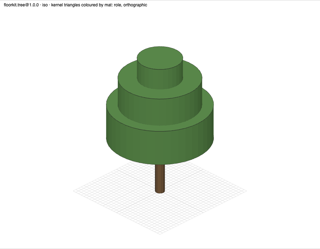 | **planting** (3): `planter`, `potted-plant`, `tree` |
| 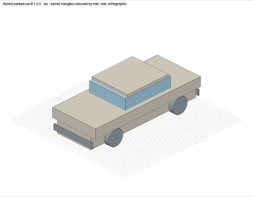 | **vehicles** (2): `bicycle`, `parked-car` |
| 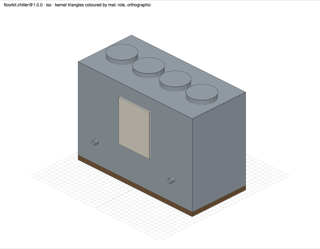 | **equipment** (10): `boiler`, `chiller`, `crah`, `hot-water-cylinder`, `pdu`, `photocopier`, `radiator`, `rear-door-heat-exchanger`, `ups`, `water-cooler` |
| 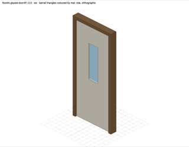 | **openings** (1): `glazed-door` |
| 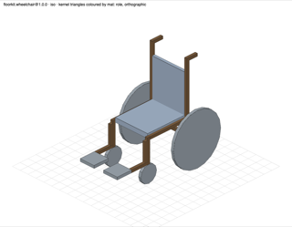 | **other** (3): `turning-circle-1500`, `wheelchair`, `wheelchair-space` |

## Where the blocks are

jsDelivr serves the catalog from its release tags. Pin a tag, never a branch:

```text
https://cdn.jsdelivr.net/gh/OpenGeometry-io/floorkit-catalog@v0.1.0/
```

| Under that URL | What |
| --- | --- |
| `index.json` | Every block: `id`, `version`, `labelName`, `type`, `category`, `tags`, `dimensions` (metres), `license`, `path`, `bytes` and `sha256` |
| `blocks/<publisher>/<slug>/<version>.op` | One block, for example `blocks/floorkit/bathtub/1.0.0.op` |
| `tools/loader.mjs` | The reference loader |

A block's `id` is `<publisher>.<slug>`, for example `floorkit.bathtub`.

## Use a block in Floorkit

The reference loader fetches a block and checks it against `index.json` before it returns the text. Copy [`tools/loader.mjs`](tools/loader.mjs) into your project: it has no dependencies and runs unchanged in browsers and in Node 22.

```js
import { BuildingSession, OpenElement } from '@opengeometry/floorkit';
import { openCatalog } from './loader.mjs';

const catalog = await openCatalog({
  baseUrl: 'https://cdn.jsdelivr.net/gh/OpenGeometry-io/floorkit-catalog@v0.1.0/',
});
const { entry, text } = await catalog.load('floorkit.bathtub');

// In a building model, Floorkit names the block by its path below blocks/.
const uri = entry.path.replace(/^blocks\//, ''); // 'floorkit/bathtub/1.0.0.op'
const session = new BuildingSession(model, { assetSources: { [uri]: text } }); // model: your BuildingModel
session.apply(
  { kind: 'add-asset', assetId: 'bathtub', asset: { kind: 'external-op', uri } },
  session.revision,
);

// On its own, as one element:
const bathtub = new OpenElement(text);
```

Place copies of the asset with `add-element`, as in Floorkit's [Place furniture](https://docs.ploterr.com/floorkit/guides/place-furniture) guide.

- **`load` checks** the byte count, the SHA-256, the `id` and the version against `index.json`. It refuses any redirect, a path outside the catalog, an oversized file and a revoked block, each with a `CatalogError` `code` ([list](SECURITY.md#what-the-catalog-already-defends-against)).
- **`index.json` itself is not signed** ([RFC 0001](docs/rfcs/0001-catalog-and-loader.md)). Without the loader, nothing checks what you fetch.

## What a block looks like

Plain JSON, documented in [docs/format-v1.md](docs/format-v1.md). You don't need Floorkit to read it. Shortened from `blocks/floorkit/simple-chair/1.0.0.op`:

```jsonc
{
  "version": 1,
  "id": "floorkit.simple-chair",                                   // <publisher>.<slug>, matching its path
  "labelName": "Dining Chair",
  "type": "FURNITURE",
  "dimensions": { "width": 0.45, "depth": 0.52, "height": 0.85 },  // metres
  "metadata": { "catalog:version": "1.0.0", "catalog:category": "seating", "catalog:lod": "300", "ifc:class": "IfcFurniture" },
  "anchors": { "base": { /* … */ }, "seatCenter": { /* … */ } },   // named mount points
  "definitions": { /* geometry written once, used by ref */ },
  "profileView": { "elements": [ /* plan symbol */ ] },
  "modelView": { "elements": [ /* 3D body */ ] }
}
```

## Work on the catalog

You need Node 22 or later.

```sh
npm ci
npm run check                              # tests, every block valid, index.json current
node tools/validate.mjs path/to/block.op   # check one file, with path-qualified errors
node tools/format.mjs path/to/block.op     # rewrite a block into its one accepted byte form
npm run index                              # regenerate index.json after adding a block
```

With a Floorkit build you can also hold every block to Floorkit itself, and draw it. CI cannot run these, so a maintainer runs them before merging when the author could not:

```sh
FLOORKIT_DIR=<dir with dist/index.js> node tools/parity.mjs --build --mesh   # accepted, unrepaired, built, mirrored, clean solids
FLOORKIT_DIR=<dir with dist/index.js> node tools/render.mjs                  # plans, elevation and 3D views of each block, under renders/
```

| Path | What |
| --- | --- |
| `blocks/<publisher>/<slug>/<x.y.z>.op` | The blocks. Immutable once in a tag |
| `index.json` | Generated by `npm run index`; never edit it by hand |
| `publishers.json`, `categories.json`, `revocations.json` | Who may publish, the 13 categories, withdrawn versions |
| `schema/` | JSON Schemas for a block (`op/v1`) and the index (`index/v1`) |
| `tools/` | Validator with the geometry gates, formatter, index builder, loader, CI gates, Floorkit parity check, renderer |
| `test/` | `node:test` suites and fixtures |
| `docs/` | The format, the drafting standard, the RFCs, the launch checklist and the gallery pictures |
| `examples/` | A demo that furnishes a flat and an office with the blocks and draws a plan, a section and two elevations (needs a Floorkit build) |
| `.claude/skills/author-block/` | The skill that walks an author, or a coding agent, from request to pull request |

## Contribute

Add `blocks/<you>/<slug>/1.0.0.op`, run `npm run check`, sign off every commit (`git commit -s`) and open a pull request with its provenance section filled in. Only self-authored work is accepted: no geometry copied from manufacturer or BIM-portal files, and no brand names in community labels.

- [docs/drafting-standard.md](docs/drafting-standard.md): how a block is drawn: the origin, true heights, the body at LOD 300, the plan symbol, roles, colours, anchors, ports and IFC class, per category.
- [The `author-block` skill](.claude/skills/author-block/SKILL.md): the order of work, from the request to the pull request, for a coding agent; with a [starter block](.claude/skills/author-block/starter.op) and the [LOD 300 review checklist](.claude/skills/author-block/references/lod300-checklist.md).
- [CONTRIBUTING.md](CONTRIBUTING.md): the full steps and what CI checks.
- [GOVERNANCE.md](GOVERNANCE.md): publisher tiers, releases, revocation and takedowns.
- [SECURITY.md](SECURITY.md): report a vulnerability privately.

## Licence

- **Blocks**, `index.json`, and the test fixtures and gallery pictures derived from them: [CC BY 4.0](LICENSES/CC-BY-4.0.txt). Credit the catalog with:

  ```text
  "floorkit-catalog" by Vishwajeet Mane and floorkit-catalog contributors,
  https://github.com/OpenGeometry-io/floorkit-catalog, CC BY 4.0
  (https://creativecommons.org/licenses/by/4.0/)
  ```

- **Schema, tools, tests and docs:** [Apache-2.0](LICENSES/Apache-2.0.txt).
- **Floorkit** is licensed separately and is not part of this repository. You don't need a Floorkit licence key to use the blocks.

[LICENSE.md](LICENSE.md) says what the licences do and do not grant.

## Plans

- [RFC 0001: catalog and loader](docs/rfcs/0001-catalog-and-loader.md): the trust model, distribution (an npm package and a signed index later) and moving the loader into the Floorkit SDK.
- [RFC 0002: toward Revit-family-like blocks](docs/rfcs/0002-parametric-families.md): what `.op` would need to work like a Revit family, and what should not be copied.
- [RFC 0003: plan line roles](docs/rfcs/0003-plan-line-roles.md): an optional `lineRole` on a plan node, so a block can draw outline, detail, overhead, hidden and swing lines, each with its own pen.
