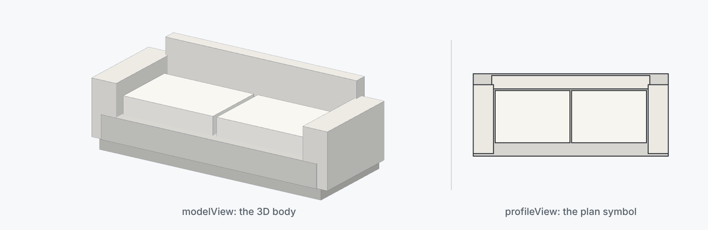

<div align="center">

<picture>
  <source media="(prefers-color-scheme: dark)" srcset="docs/images/minimal-sofa-dark.png">
  
</picture>

# floorkit-catalog

**Free, reusable building blocks for [Floorkit](https://ploterr.com/floorkit), one plain JSON file each.**

[](https://github.com/OpenGeometry-io/floorkit-catalog/actions/workflows/validate.yml)
[](LICENSES/CC-BY-4.0.txt)
[](LICENSES/Apache-2.0.txt)

</div>

> **Coding agents:** read [AGENTS.md](AGENTS.md) before you change anything in this repository.

## What it is

Furniture, sanitaryware, kitchen runs, doors, planting, vehicles and data-centre equipment. Each block is one `.op` file with a plan symbol, a 3D body and named anchors.

- **26 blocks in 10 categories** in v0.1.0, listed in [`index.json`](index.json).
- **A released block never changes.** A fix is a new version in a new file, so a URL pinned to a tag always serves the same bytes.
- **Stricter than Floorkit.** The catalog refuses anything Floorkit would silently repair, so a block draws exactly as written.

## Quick start

jsDelivr serves the catalog from its release tags. Pin a tag, never a branch:

```text
https://cdn.jsdelivr.net/gh/OpenGeometry-io/floorkit-catalog@v0.1.0/
```

| Under that URL | What |
| --- | --- |
| `index.json` | Every block: `id`, `version`, `labelName`, `type`, `category`, `tags`, `dimensions` (metres), `license`, `path`, `bytes` and `sha256` |
| `blocks/<publisher>/<slug>/<version>.op` | One block, for example `blocks/floorkit/bathtub/1.0.0.op` |
| `tools/loader.mjs` | The reference loader |

A block's `id` is `<publisher>.<slug>`, for example `floorkit.bathtub`. Copy [`tools/loader.mjs`](tools/loader.mjs) into your project: it has no dependencies and runs unchanged in browsers and in Node 22.

## Usage

### With Floorkit

```js
import { BuildingSession, OpenElement } from '@opengeometry/floorkit';
import { openCatalog } from './loader.mjs';

const catalog = await openCatalog({
  baseUrl: 'https://cdn.jsdelivr.net/gh/OpenGeometry-io/floorkit-catalog@v0.1.0/',
});
const { entry, text } = await catalog.load('floorkit.bathtub');

// In a building model, Floorkit names the block by its path below blocks/.
const uri = entry.path.replace(/^blocks\//, ''); // 'floorkit/bathtub/1.0.0.op'
const session = new BuildingSession(model, { assetSources: { [uri]: text } }); // model: your BuildingModel
session.apply(
  { kind: 'add-asset', assetId: 'bathtub', asset: { kind: 'external-op', uri } },
  session.revision,
);

// On its own, as one element:
const bathtub = new OpenElement(text);
```

Place copies of the asset with `add-element`, as in Floorkit's [Place furniture](https://docs.ploterr.com/floorkit/guides/place-furniture) guide.

### Without Floorkit

A block is plain JSON, so any tool can read it. `load` also returns the parsed `definition`:

```js
const { definition } = await catalog.load('floorkit.minimal-sofa');
definition.dimensions; // { width: 2.32, depth: 0.98, height: 0.78 }, in metres
```

- **`load` checks** the byte count, the SHA-256, the `id` and the version against `index.json`. It refuses any redirect, a path outside the catalog, an oversized file and a revoked block, each with a `CatalogError` `code` ([list](SECURITY.md#what-the-catalog-already-defends-against)).
- **`index.json` itself is not signed yet** ([RFC 0001](docs/rfcs/0001-catalog-and-loader.md)). Without the loader, nothing checks what you fetch.

## Block format

Documented in [docs/format-v1.md](docs/format-v1.md). Shortened from `blocks/floorkit/simple-chair/1.0.0.op`:

```jsonc
{
  "version": 1,
  "id": "floorkit.simple-chair",                                   // <publisher>.<slug>, matching its path
  "labelName": "Simple Chair",
  "type": "FURNITURE",
  "dimensions": { "width": 0.64, "depth": 0.64, "height": 0.96 },  // metres
  "metadata": { "catalog:version": "1.0.0", "catalog:category": "seating", "ifc:class": "IfcFurniture" },
  "anchors": { "seatCenter": { /* … */ } },                        // named mount points
  "profileView": { "elements": [ /* plan symbol */ ] },
  "modelView": { "elements": [ /* 3D body */ ] }
}
```

## Develop

You need Node 22 or later.

```sh
npm ci
npm run check                              # tests, every block valid, index.json current
node tools/validate.mjs path/to/block.op   # check one file, with path-qualified errors
node tools/format.mjs path/to/block.op     # rewrite a block into its one accepted byte form
npm run index                              # regenerate index.json after adding a block
```

Maintainers with a Floorkit build can also check every block in Floorkit itself: `FLOORKIT_DIR=<dir with dist/index.js> node tools/parity.mjs --build`.

The repository layout, and who writes each path, is in [AGENTS.md](AGENTS.md#layout).

## Contributing

Add `blocks/<you>/<slug>/1.0.0.op`, run `npm run check`, sign off every commit (`git commit -s`) and open a pull request with its provenance section filled in. Only self-authored work is accepted: no geometry copied from manufacturer or BIM-portal files, and no brand names in community labels. [CONTRIBUTING.md](CONTRIBUTING.md) has the full steps and what CI checks; [GOVERNANCE.md](GOVERNANCE.md) covers publisher tiers, releases, revocation and takedowns.

## Security

Report a vulnerability privately, never in a public issue: see [SECURITY.md](SECURITY.md).

## Licence

- **Blocks**, `index.json`, the test fixtures and the banner above, all derived from the blocks: [CC BY 4.0](LICENSES/CC-BY-4.0.txt). Credit the catalog with:

  ```text
  "floorkit-catalog" by Vishwajeet Mane and floorkit-catalog contributors,
  https://github.com/OpenGeometry-io/floorkit-catalog, CC BY 4.0
  (https://creativecommons.org/licenses/by/4.0/)
  ```

- **Schema, tools, tests and docs:** [Apache-2.0](LICENSES/Apache-2.0.txt).
- **Floorkit** is licensed separately and is not part of this repository. You don't need a Floorkit licence key to use the blocks.

[LICENSE.md](LICENSE.md) says what the licences do and do not grant.

## Roadmap

- [RFC 0001: catalog and loader](docs/rfcs/0001-catalog-and-loader.md): the trust model, distribution (an npm package and a signed index later) and moving the loader into the Floorkit SDK.
- [RFC 0002: toward Revit-family-like blocks](docs/rfcs/0002-parametric-families.md): what `.op` would need to work like a Revit family, and what should not be copied.
